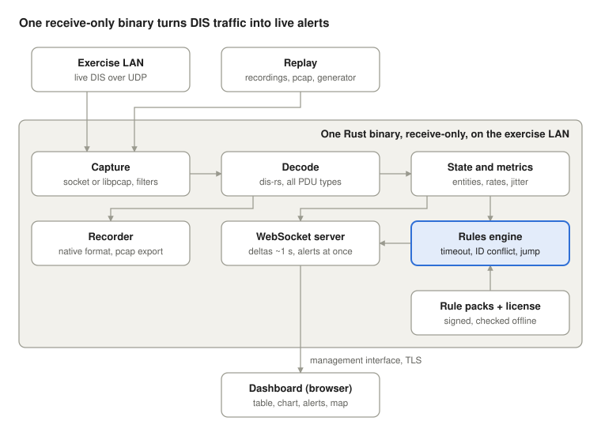

# NetworkNinja — DIS Live Monitor MVP Spec

Last updated: 2026-10-28. Living copy: the Claude Docs spec this file was exported from.

## Concept

A live observability tool for distributed simulation: metrics, alerts and dashboards for DIS traffic, the way Datadog works for services. HLA comes later.

The gap: existing tools are protocol inspectors (ASTi RedSim 2, DIS Tool) or RTI consoles tied to one vendor. None of them offer alerting, baselines or a view across protocols.

**Primary user:** the sim/network engineer at exercise control, who needs to know within seconds that a federate dropped, an ID collided or an entity misbehaved, before the training audience notices.

**One-line pitch:** catch exercise-breaking network and simulation faults live, instead of finding them in the after-action review.

## Goals and non-goals

The MVP proves one thing: three alerts that fire correctly on live DIS traffic, with a dashboard someone at exercise control would leave open.

**Goals**

- Passive capture of DIS v6 and v7, live or from a recording
- Live entity table, traffic metrics and a map
- Three alert rules with near-zero false positives on a clean exercise
- Runs as one binary on an air-gapped exercise LAN, on Windows, macOS or Linux; the dashboard works in any modern browser on desktop, tablet or phone

**Non-goals for the MVP**

- HLA, TENA or any protocol other than DIS
- Sending PDUs, or any active participation in the exercise
- Long-term storage, historical queries across exercises, or replay onto the network
- Role-based access, SSO or hosted SaaS

## Architecture

Everything runs in one Rust process: capture, decode, state, rules, recorder and the WebSocket server. The browser only reads from it.

Live and replayed traffic take the same path, so every test exercises the production code. State feeds both the rules and the dashboard; alerts skip the 1 s batch.

**Stack:** Rust with dis-rs for everything server-side; TypeScript, a charting library and MapLibre on the frontend; in-memory ring buffers for storage, with a time-series DB later. Skip the Python prototype, since milestone 1 already gives a working console tool.

## Capture and decode

Capture is passive and receive-only; decoding uses an existing library, not a hand-written parser.

**Capture**

- UDP listener on a configurable interface and port (DIS default 3000), with broadcast and multicast support
- Multicast requires an explicit IGMP join on the chosen interface. Test on a real switched LAN early, not only on localhost.
- SPAN/mirror-port capture through libpcap, so unicast DIS between other hosts is visible too. Socket mode stays for simple setups.
- Several ports, multicast groups and exercises at once; each exercise ID gets its own state, metrics and dashboard view
- Filters: exercise ID, site, application, PDU type
- Replay from pcap or a recorded file, played at 1x or faster, so tests don't need a live exercise
- One datagram can carry several PDUs; split them using the length field in each PDU header
- Kernel and application packet drops are counted and shown, so the tool says when it is missing traffic

**Decode**

- Library: dis-rs (Rust). Before committing, confirm it covers every DIS v6 and v7 PDU type, not only v7.
- Versions: DIS v6 (IEEE 1278.1a-1998) and v7 (IEEE 1278.1-2012)
- All PDU types: header and enumerated fields decoded, so every PDU gets the rule pack's enumeration checks
- Deep decode (feeds state, metrics and dashboard): Entity State, Fire, Detonation, Start/Resume, Stop/Freeze, Remove Entity
- Unknown or malformed PDUs are counted and logged, never dropped silently. A malformed rate is a useful metric in itself.
- Decoders are fuzz-tested against malformed and hostile input; a bad packet must never crash the monitor

**Time**

- Stamp every PDU with the local receive time. That stamp drives all rates and timeouts.
- Record the PDU's own timestamp too, and note whether it is absolute or relative. Treat sender clocks as untrusted until the system has checked their skew.

## State and metrics

The system keeps per-entity state keyed by the full Entity ID (site/application/entity) together with the sender's address. Aggregate metrics are computed over rolling windows.

**Per-entity state**

| Field | Notes |
| --- | --- |
| Entity ID | site/application/entity triple |
| Source | sender IP:port seen on first and latest PDU |
| Type and marking | entity type record and the marking text |
| Last seen | local receive time |
| Kinematics | position (ECEF), velocity, orientation, dead-reckoning algorithm and parameters |
| Appearance | including the deactivated and frozen bits |
| Heartbeat interval | rolling mean and variance of the gap between Entity State PDUs |

**Aggregate metrics** (1 s, 10 s and 60 s windows)

- PDU rate by type, by site and by sender
- Bytes/sec in and out of the filter
- Active entity count, by site and by type
- Heartbeat jitter per entity (variance of the interval). Per-packet jitter on a LAN is mostly noise.
- Malformed and unknown PDU counts
- Exercise state: running or frozen, from Start/Resume and Stop/Freeze

Every sample is tagged from one dimension set (exercise, site, entity, sender, PDU type, kind, force, pack, rule, severity) and named from a stable catalogue (`pdu.count`, `bytes.count`, `datagram.count`, `decode.errors`, `entity.active`, `entity.heartbeat_mean`, `entity.heartbeat_jitter`, `entity.dr_error`, `alerts.open`; ADR 0008). Ten minutes stay in memory at one-second resolution (ten seconds for per-entity gauges); with `--db`, ten-second rollups persist in SQLite for `--metrics-retention` days (default 7). `GET /api/query?name=…&where.DIM=…&by=…&agg=…&window=…&from=…&to=…` answers any of them as a timeseries per group, or one value per group when the window spans the range.

## Alert rules

The MVP ships three rules, each defined so that it stays quiet on a healthy exercise. No rule fires on an entity while it is frozen: a Stop/Freeze applies to the exercise, site or application its receiving ID addresses (65535 = all), and a Start/Resume resumes every freeze it covers. Rule timing runs on a steady clock for live capture, so an NTP or PTP step on the monitor host doesn't look like every entity going silent.

| Rule | Fires when | Suppressed when | Default |
| --- | --- | --- | --- |
| Entity timeout | No Entity State from an entity for longer than its heartbeat × multiplier | Remove Entity received (wildcards expand to every matching entity); deactivated appearance bit set; a tracked munition's Detonation; frozen time doesn't count, and senders get one heartbeat of grace after a resume. An open timeout stays open when the silent entity ages out of the table | 5 s heartbeat × 2.4 = 12 s |
| Entity ID conflict | The same site/application/entity triple arrives from two different source IP:port pairs, or with a different entity type | A single source whose port changes after a restart (no overlap within 2 s); byte-identical copies from a relay within 1 s (`duplicate_window`; counted as `pdu.duplicates`) | Any overlap |
| Position jump | The reported position differs from the dead-reckoned prediction by more than the tolerance | First report from a sender; an entity reappearing after a timeout; the first report after a freeze or resume. Body-axis DR (algorithms 6–9) rotates velocity and acceleration from body to world axes | 3× sender DR threshold, plus a physical speed cap per entity kind |

**Why these definitions**

- **ID conflict:** the site number is part of the Entity ID, so two sites can never claim the same ID. The real fault is two simulators using the same site/application numbers.
- **Position jump:** senders only send an update when their own dead-reckoning error passes a threshold. Comparing raw positions therefore flags normal behaviour. Extrapolate from the last Entity State using the algorithm and parameters it carried, then compare.

**Alert lifecycle:** firing, then resolved, then cleared. Alerts are de-duplicated per entity and rule, and every transition is logged with the PDU that triggered it.

## Rule packs

Rules are data, not code. Each message set has a versioned rule pack that the engine loads at startup, so adding or updating rules never needs a new build. The focus is the standard DIS PDU families: the base pack carries rules for every PDU type in DIS v6 and v7, not only the six the MVP dashboard decodes in depth. The three MVP alerts are its first behavioural rules.

**Sources for each pack**

| Pack | Source | How it's built |
| --- | --- | --- |
| DIS enumerations | SISO-REF-010 (machine-readable distribution) | Generated: valid entity types, force IDs, PDU types and other enumerated fields |
| DIS structure and behaviour | IEEE 1278.1 and 1278.2 | Hand-authored once: field sizes and lengths, heartbeat and timeout defaults, dead-reckoning algorithms |
| HLA federation (later) | The federation's FOM XML, e.g. RPR FOM | Generated per federation from its object and interaction classes |
| Custom message sets | Program ICDs or custom PDU definitions | Customer- or integrator-authored, using the same format |
| Site and exercise overrides | The customer | Allowed site IDs, expected entity types, tighter timeouts |

**How packs work**

- Declarative files: each rule names a message type, a condition, a threshold and a severity, e.g. Entity State heartbeat ≤ 5 s → warning
- Layered: standard pack → exercise profile → site overrides; the most specific layer wins
- Every alert shows which pack and rule fired, with a link to the source reference
- Signed and versioned like license files, delivered in the same offline update bundles. A new SISO-REF-010 release becomes a pack update, not a product release.
- Packs are validated on load; a bad pack is rejected and the previous one keeps running

**Conformance view:** shows rule hits per sender (site/application), so integration events can see which simulator is non-compliant and why. This is also a selling point for the Pro tier.

**Coverage by PDU family:** each family (Entity Information, Warfare, Simulation Management, Logistics, Radio Communications, Distributed Emission Regeneration, and the rest) gets its own section in the base pack. Enumeration checks apply to every PDU on day one, because they are generated. Behavioural rules are added family by family, starting with Entity Information and Warfare.

**Custom message sets (later):** program-specific PDU layouts declared in a pack, so non-standard traffic can be decoded and checked without new code. Sold as a separately licensed add-on (see Business model).

Pack file format: a deliberately small TOML subset, parsed with no dependencies so the binary stays self-contained (see [rule-packs.md](rule-packs.md)). Still open: whether to compile packs to a binary form, and whether to adopt or extend an existing schema.

## Web UI

The dashboard is a single page fed over WebSocket. The server pushes aggregated state about once per second, and alerts are pushed the moment they fire.

- **Header:** exercise ID, running/frozen state, entity count, PDU/s, open alert count
- **Exercise selector:** switch between exercises seen on the network
- **Traffic chart:** PDU rate by type, with a 10-minute rolling window
- **Entity table:** sortable and filterable by site, type and status, with stale entities greyed out
- **Alert feed:** newest first; clicking an alert focuses the entity in the table and on the map
- **Operator actions:** acknowledge an alert, mute by entity or rule (with an expiry), add a note; optional audible alarm for new critical alerts
- **Map:** MapLibre with an offline tile set (no tile server on air-gapped LANs). Positions are converted from ECEF to lat/lon on the server.
- **Monitor health:** capture drops, CPU, memory, rule pack versions, license status
- **Outputs:** alerts forwarded to syslog/CEF; export of alerts and an exercise summary report (CSV and PDF)

**Devices:** one responsive layout serves desktop, tablet and phone browsers, so nothing is installed on viewing devices. A phone shows the alert feed and key counts first; a tablet shows the map beside the alerts; a desktop shows everything. Operator actions (acknowledge, mute, note) are touch-friendly. The dashboard can be added to a home screen as a Progressive Web App for full-screen use, which avoids app-store installs on managed devices.

To keep the browser responsive above about 1,000 entities, the server sends deltas, not the full state, and the map draws entities as a single symbol layer.

## Record and replay

Recording and replay are built in, so nobody needs Wireshark or a separate logger. A recording is a first-class object: start it, name it, replay it, share it.

**Recording**

- One click (or always-on ring buffer) records decoded PDUs with their raw bytes and receive timestamps
- Native recording format: indexed by time and entity, so seeking is instant and files can be filtered and trimmed
- Exercise metadata saved with each recording: exercise ID, sites, rule pack versions, alerts raised
- Import pcap/pcapng and common DIS logger files; export to pcap for anyone who still wants Wireshark

**Replay modes**

| Mode | What it does | Network |
| --- | --- | --- |
| Into the dashboard | Plays a recording through the same pipeline as live traffic: entity table, map, rules and alerts | No transmit; safe anywhere |
| Onto the network | Re-broadcasts PDUs to a chosen port and interface, for testing other simulators or reproducing a fault | Transmits; off by default, explicit opt-in, separate interface |
| HLA (later) | Replays recorded attribute updates and interactions into the dashboard; re-publishing into a live federation as a federate comes after that | Federate join required for re-publishing |

**Controls:** play, pause, 0.1× to 50× speed, seek on a timeline, loop a section, jump to an alert. Filters by site, entity, PDU type or time window, so a single fault can be replayed in isolation. Replay can rewrite exercise ID and timestamps so replayed traffic doesn't collide with a live exercise.

**Timeline view:** alerts and key events (Fire, Detonation, Stop/Freeze) shown as markers on the scrubber, so you can jump straight to the moment something went wrong.

**Scope:** the MVP covers DIS recording and replay into the dashboard. Replay onto the network and HLA replay come later. Network replay breaks the receive-only guarantee, so it ships as a separately enabled feature and is documented as such for security reviews.

## Test data

The synthetic generator is built in milestone 1, not later: every rule needs a fault it can be tested against, and real recordings may take months to obtain.

**Synthetic generator**

- Emits N entities over several sites/applications, moving on simple paths with realistic dead-reckoning updates and 5 s heartbeats
- One fault-injection flag per rule:
  - `--drop-heartbeat <id>`: stop sending one entity without a Remove Entity PDU
  - `--clone-id <id>`: a second sender reuses an existing Entity ID
  - `--teleport <id>`: move an entity far beyond its dead-reckoning prediction
- Control faults that must **not** fire: a clean Remove Entity, a Stop/Freeze followed by a Resume, and a sender restarting on a new port
- Can write a pcap, so every scenario becomes a repeatable regression test

**Real data**

- Ask partner programs or the user community for unclassified recordings
- Use any public DIS sample captures and the logging tools from the Open-DIS ecosystem as early sanity checks

## Deployment and security

The MVP ships as one self-contained binary that runs on the exercise LAN. A hosted version can come later, for unclassified training only.

- One Rust binary with the frontend, offline map tiles and the config built in
- Server platforms: Windows, macOS and Linux, on x86-64 and ARM64, each a single binary; STIG-hardened RHEL and Windows come first for accreditation. Viewers need only a modern browser on a desktop, tablet or phone
- No outbound network calls, telemetry or update checks
- Receive-only on the capture interface: the tool never transmits onto the exercise network. The one exception, network replay, is a separately enabled Pro feature on its own interface.
- The dashboard is served on a separate management interface, with TLS and local user accounts so several people can watch. It stays bound to localhost until configured.
- Audit log of logins, config changes, alert acknowledgements and recordings
- Every release ships as a signed binary with an SBOM; dependencies are scanned for known vulnerabilities

**Recording handling**

- No PDU payloads are persisted by default; recording is opt-in, and so is tiered PDU capture (`--capture`, ADR 0009), which writes its own file under a byte budget
- Each recording carries the exercise's classification marking and a retention period
- Secure deletion on expiry or on request; encryption at rest, configurable per site

This answers most classification questions for the MVP. Formal accreditation (for example, an ATO on DoD networks) is a later, customer-driven step.

## Operations

The monitor must be trustworthy under load, easy to configure per exercise and supportable without network access.

**Performance targets** (proposed; confirm against real exercise sizes)

- 10,000 active entities and 50,000 PDU/s sustained on a mid-range server, with zero capture drops
- A memory ceiling at that load, set during milestone 2 testing
- Alert latency under 2 s at that load

**Configuration**

- Exercise profiles: ports, multicast groups, filters, rule packs and thresholds, saved and reused
- Thresholds per entity kind: munitions, radios and vehicles have different heartbeats and speed limits
- Config files can be imported and exported, so a profile can move between sites on approved media

**Time**

- NTP or PTP on the monitor host is recommended; clock skew per sender is measured and shown

**Supportability**

- A one-click diagnostic bundle (logs, config, health metrics, no PDU payloads) the customer can review and carry out
- An operator runbook and an install guide written for air-gapped sites

## Business model and licensing

The product is sold as an on-prem term license, renewed annually, rather than as SaaS. Most target exercises run on air-gapped or classified networks that a hosted service cannot reach.

**Why not SaaS first**

- Exercise data usually cannot leave the enclave
- Hosted services for DoD need FedRAMP and impact-level authorization, which is slow and costly before the first sale
- Buyers (program offices, sim centers, ranges, integrators) already buy installed software

**Commercial terms**

| Option | Structure | Fits |
| --- | --- | --- |
| Term license (default) | Annual fee per site or per exercise network; updates and support included | Buyers with operating budgets; gives recurring revenue |
| Perpetual + maintenance | One-time license plus an annual maintenance fee | Buyers who find capital purchases easier |
| OEM / integrator | Bundled into an integrator's or sim vendor's delivery | Programs where the integrator already holds the contract |

**Tiers**

- **Base:** DIS monitoring, the core alert rules and base rule pack, dashboard and map, recording and replay into the dashboard
- **Pro:** adds the conformance view, HLA, multiple sensors per site, custom rules and network replay
- **Enterprise:** adds the central server, long-term storage, cross-exercise analysis and after-action reports

**Add-on: custom message sets.** Decoding and rule checks for program-specific PDUs, licensed per message set on top of any tier. Optionally sold with paid services to author the pack from the customer's ICD.

Upselling means issuing a new license file, not a new install.

**Licensing in the product**

- A license file signed with the vendor key and checked locally: customer, site, tier, limits (sensors or entities), expiry. Nothing phones home.
- Expiry warns first, then runs on during a grace period. Monitoring is never cut off in the middle of an exercise.
- Updates ship as signed offline bundles with published checksums, carried in on approved media
- Licensing is built in milestone 7, before the first paid trial; tier checks only gate features that come after the MVP

**Go-to-market**

- Entry route: SBIR/STTR (or national equivalent) to fund development and win a first government customer
- Partner with integrators and sim vendors, who are already on the contracts
- SaaS later, only for unclassified and commercial training (academic labs, allied training centers, commercial aviation sim)

Open questions: price points per tier; export-control classification of the software; whether to sell direct or only through partners in year one; whether SISO terms allow redistributing SISO-REF-010 data inside rule packs; whether dis-rs's license and those of other dependencies allow commercial distribution. Get legal advice on license terms and export controls before the first sale.

## Milestones

There are seven milestones, each with an exit test. The generator comes first because every later exit test runs against it. Milestones 1 to 6 are the MVP; milestone 7 makes it sellable. Status at 2026-10-28: milestone 1 is mostly done, and the cores of milestones 2 and 3 (entity state, metrics, the three alert rules) are built and tested; the repository README tracks the details.

1. **Generator + capture + decoder.** Exit: decodes 100% of generator output for v6 and v7, by socket, by libpcap and from pcap; every PDU type decoded to header and enumerated fields; the decoder survives a fuzzing run with no crash.
2. **Entity state, metrics and monitor health.** Exit: entity count and PDU rates match the generator's ground truth within 1%; capture drops are reported; memory and throughput measured against the performance targets.
3. **Rule packs + three alert rules.** Exit: the pack loader validates and layers packs; enumeration checks generated from SISO-REF-010 run on every PDU; each injected fault fires its alert within 2 s; control scenarios produce zero alerts over 30 minutes.
4. **Dashboard + map.** Exit: an alert appears in the browser within 2 s; acknowledge and mute work; the UI stays responsive at the target entity count; the map works with no internet; TLS and local accounts let several viewers watch; the layout works on a phone and a tablet as well as a desktop browser.
5. **Record and replay.** Exit: a recording made in the app replays into the dashboard with seek, speed and filters, and raises the same alerts as the live run; pcap import and export work.
6. **Demo.** Exit: a scripted 15-minute run on recorded or synthetic traffic, showing all three faults caught live and then replayed.
7. **Release readiness.** Exit: signed license files checked offline with a grace period; signed binaries and an SBOM; audit log; diagnostic bundle; install guide for air-gapped sites; signed builds for Windows, macOS and Linux.

Open question: a target date for each milestone.

## Later, risks and open questions

**Later**

- HLA through a passive federate, starting with Portico, then RTI-agnostic; views that understand the FOM
- Entity-centric traces: Fire → Detonation → damage chains, linked by event ID
- Baselines learned per exercise type, used for anomaly alerts
- After-action analysis and replay, with a time-series store
- More rules: dead-reckoning parameter abuse, bandwidth spikes, sender clock skew, orphan Detonations

**Risks**

| Risk | Mitigation |
| --- | --- |
| dis-rs coverage gaps (all PDU types, v6) or bugs | Test coverage of every PDU type in milestone 1; fall back to a thin custom decoder for headers and the 6 deep-decoded PDU types |
| False positives erode trust | Control scenarios in the test suite; per-rule thresholds; a mute button per entity |
| No access to real exercise data | Synthetic generator first; seek partners early |
| Buyers need accreditation before any trial | Receive-only, air-gapped design; document the security posture up front |

**Open questions**

- Who provides the first real recordings, and under what handling terms?
- Is the first buyer a program office, a sim center or an integrator?
- Which DIS versions and vendors do target exercises actually run?
